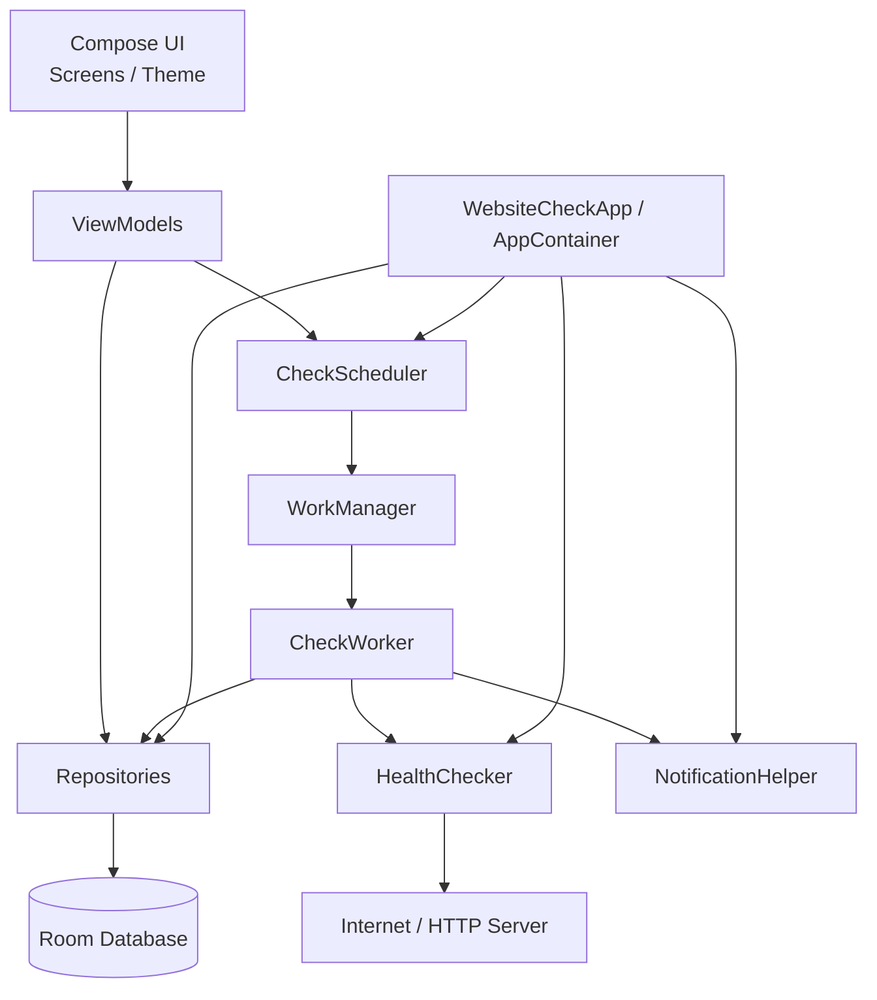
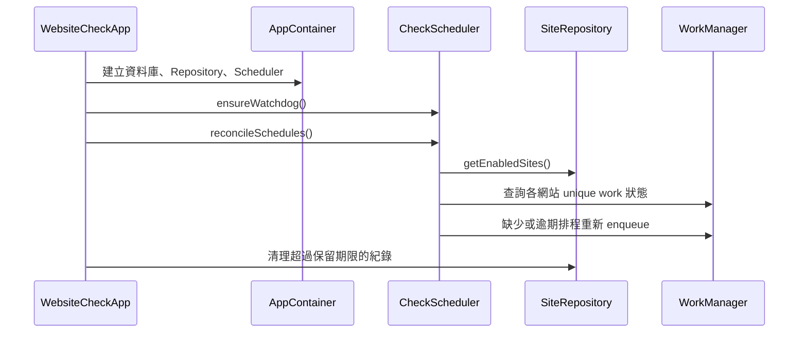
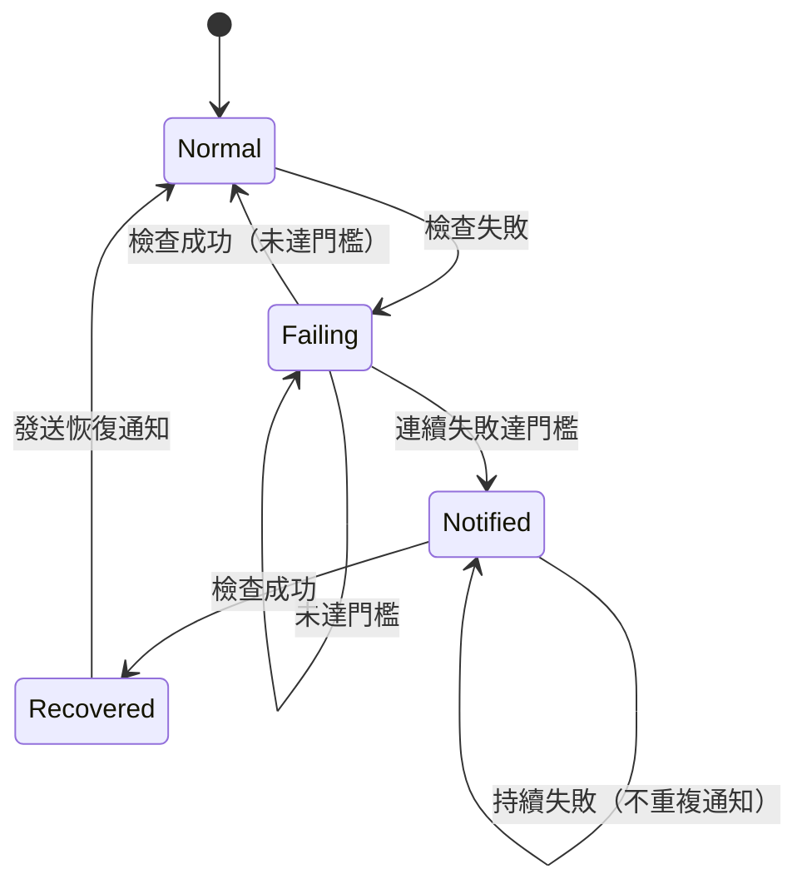

# 系統架構與技術文件

## 1. 概觀

「網站健康檢查」是單一 Android 應用程式模組（`app`），採用 Kotlin、Jetpack Compose 與 MVVM 分層設計。應用程式完全在本機運作，不需要帳號或後端伺服器。

主要能力：

- 管理多個網站設定
- 依排程透過 HTTP 檢查網站
- 保存檢查紀錄
- 依狀態變化發送通知
- 匯出 CSV
- 顯示模式與系統列主題同步

## 2. 技術棧

| 類別 | 版本／技術 |
|---|---|
| 語言 | Kotlin 2.1.20 |
| Android Gradle Plugin | 8.10.1 |
| Gradle | 8.11.1 |
| compileSdk / targetSdk | 36 |
| minSdk | 26 |
| UI | Jetpack Compose、Material 3 |
| 導覽 | Navigation Compose 2.8.0 |
| 狀態管理 | ViewModel、StateFlow、Compose State |
| 資料庫 | Room 2.6.1（KSP） |
| 背景工作 | WorkManager 2.10.1 |
| 網路 | OkHttp 4.12.0 |
| 非同步 | Kotlin Coroutines 1.10.2 |
| 測試 | JUnit 4、MockWebServer |

## 3. 分層架構



### 3.1 UI 層

位置：`app/src/main/java/com/websitecheck/app/ui`

- `MainActivity`：設定 Compose 內容、通知權限、啟動時排程校正。
- `WebsiteCheckApp`（Compose）：底部導覽與 NavHost。
- `site/`：網站清單、編輯畫面與 ViewModel。
- `log/`：檢查紀錄、篩選、詳情與 CSV 匯出。
- `settings/`：顯示模式、通知、保留天數、排程診斷、背景執行與資料匯出。
- `theme/`：Material 3 色系、顯示模式與系統列樣式。
- `components/`、`Format.kt`：共用 UI 與格式化工具。

畫面不直接存取資料庫或網路，透過 ViewModel 呼叫 Repository 或 Scheduler。

### 3.2 ViewModel 層

- `SiteListViewModel`：網站清單、排序、啟用切換、立即檢查與檢查中狀態。
- `SiteEditViewModel`：表單狀態、驗證、重複網址檢查、儲存與刪除。
- `LogViewModel`：篩選、紀錄查詢、依篩選匯出 CSV。
- `SettingsViewModel`：設定持久化、排程診斷、重新排程、匯出全部紀錄、清除紀錄。

ViewModels 繼承 `AndroidViewModel`，透過 `WebsiteCheckApp.container` 取得依賴。

### 3.3 資料層

位置：`app/src/main/java/com/websitecheck/app/data`

- `AppDatabase`：Room 資料庫，版本 2。
- `SiteEntity`、`CheckLogEntity`：資料表實體。
- `SiteDao`、`CheckLogDao`：資料存取。
- `SiteRepository`：網站與紀錄的交易邏輯。
- `SettingsRepository`：SharedPreferences 設定。
- `LogWithSite`：紀錄與網站名稱／網址的查詢結果。
- `LogCsv`：CSV 產生與欄位跳脫。
- `SiteSortOption`、`ThemeMode`：排序與顯示模式列舉。

### 3.4 網路層

`network/HealthChecker.kt`

- 使用 OkHttp。
- 每個網站可設定連線／讀取／寫入逾時與 call timeout。
- HEAD 請求遇到 405／501 時自動改用 GET。
- 啟用內容檢查時強制使用 GET。
- 可設定是否跟隨 HTTP／HTTPS 轉址。
- 使用 `peekBody(1_000_000)` 讀取最多 1 MB 內容進行字串比對。
- 捕獲並分類錯誤：
  - `DNS`：`UnknownHostException`
  - `TIMEOUT`：`SocketTimeoutException`
  - `TLS`：`SSLException`
  - `NETWORK`：其他 `IOException`
  - `INVALID_URL`：`IllegalArgumentException`
  - `OTHER`：其他例外
- 不繞過 SSL 憑證驗證。

`CheckOutcome` 包含成功與否、HTTP 狀態、回應時間、錯誤類型、錯誤訊息與最終網址。

### 3.5 排程層

位置：`app/src/main/java/com/websitecheck/app/work`

- `ScheduleCalculator`：計算下一次檢查時間。
- `OverdueEvaluator`：判斷網站是否逾期（5 分鐘寬限、時間區段與星期）。
- `CheckScheduler`：建立／取消 WorkManager 工作、查詢狀態、看門狗與啟動時校正。
- `CheckWorker`：實際執行檢查、寫入紀錄、通知與安排下一次檢查。
- `WatchdogWorker`：每 15 分鐘校正逾期或中斷的排程。
- `TimeChangeReceiver`：時間或時區變更時重新排程。

### 3.6 通知層

`notify/NotificationHelper.kt`

- 通知頻道：`website_status`（重要性 High）。
- 異常與恢復通知使用不同的 notification id。
- 點擊通知開啟 `MainActivity`。
- 發送前檢查：
  - App 通知設定是否開啟
  - Android 13+ `POST_NOTIFICATIONS` 權限
  - 系統通知與頻道是否可用

## 4. 應用程式啟動流程



`MainActivity` 每次回到前景（`onStart`，60 秒節流）會再校正一次；逾期網站會立即補檢查。

## 5. 排程設計

### 5.1 WorkManager 工作

- 每個網站使用唯一名稱：`check_site_<siteId>`
- Tag：`website_health_check`
- 工作類型：`OneTimeWorkRequest`
- 限制：`NetworkType.CONNECTED`
- 初次延遲由 `ScheduleCalculator` 計算
- 看門狗：`PeriodicWorkRequest`，每 15 分鐘，唯一名稱 `schedule_watchdog`，無網路限制

### 5.2 自我重排

`CheckWorker` 完成後：

- 若網站仍啟用，使用 `APPEND_OR_REPLACE` 安排下一次。
- 若網站已停用或刪除，取消排程。
- 重排在 `NonCancellable` 中執行，避免工作被停止時漏掉下一次排程。

儲存設定或手動重新排程時使用 `REPLACE`，避免舊設定殘留。

### 5.3 校正機制

`reconcileSchedules(forceReschedule)`

- 僅處理啟用中的網站。
- 狀態為 `RUNNING` 時跳過，避免中斷執行中的檢查。
- 逾期網站一律以 `REPLACE` + 立即執行補檢查。
- `forceReschedule = true` 時取消並重建非逾期、非執行中的排程。
- 觸發時機：
  - App 啟動
  - MainActivity 回到前景（60 秒節流）
  - 看門狗每 15 分鐘
  - 時間／時區變更
  - 使用者按下「重新排程」

### 5.4 逾期判斷

`OverdueEvaluator.isOverdue()`

1. 停用、未設定星期或目前不在時間區段內 → 不視為逾期。
2. 以 `lastCheckAt ?: createdAt` 為基準計算應跑時間。
3. 目前時間超過應跑時間 5 分鐘以上 → 逾期。
4. 逾期時由看門狗或前景校正立即補檢查。

看門狗本身仍受 Doze／OEM 省電限制，無法保證 30 分鐘準時執行。

### 5.5 下次時間計算

`ScheduleCalculator.nextRunMillis()`

1. 檢查 `daysOfWeek` 是否有啟用日。
2. 正規化間隔，最低 15 分鐘。
3. 決定目標時間：
   - `forceImmediate = true` 或尚未檢查過：目前時間
   - 其他：`max(now, lastCheckAt + interval)`
4. 從昨天到今天往後 7 天，尋找符合啟用星期與時間區段的時段。
5. 若目標時間在區段內，回傳目標時間。
6. 若目標時間早於區段開始，回傳區段開始。
7. 若目標時間已超過區段結束，跳過該日。
8. 支援跨午夜區段。

## 6. 資料模型

### 6.1 `sites`

| 欄位 | 型別 | 說明 |
|---|---|---|
| id | Long | 主鍵 |
| name | String | 網站名稱 |
| url | String | 正規化網址 |
| enabled | Boolean | 是否啟用 |
| method | String | HEAD／GET |
| timeoutMs | Int | 逾時毫秒 |
| expectedStatusMin/Max | Int | 預期狀態碼範圍 |
| followRedirects | Boolean | 是否跟隨轉址 |
| keywordCheckEnabled | Boolean | 是否啟用內容字串檢查 |
| expectedKeyword | String | 預期內容字串 |
| failureThreshold | Int | 失敗通知門檻 |
| daysOfWeek | Int | 星期 bitmask（bit 0 = 星期一） |
| windowStartMinutes/EndMinutes | Int | 每日時間區段（分鐘） |
| intervalMinutes | Int | 檢查間隔 |
| createdAt | Long | 建立時間 |
| lastCheckAt | Long? | 上次檢查時間 |
| lastSuccess | Boolean? | 上次結果 |
| lastLatencyMs | Long? | 上次回應時間 |
| lastStatus | Int? | 上次 HTTP 狀態 |
| lastError | String? | 上次錯誤訊息 |
| consecutiveFailures | Int | 連續失敗次數 |
| notifiedFailure | Boolean | 是否已發送異常通知 |

### 6.2 `check_logs`

| 欄位 | 型別 | 說明 |
|---|---|---|
| id | Long | 主鍵 |
| siteId | Long | 外鍵，刪除網站時 CASCADE |
| checkedAt | Long | 檢查時間 |
| success | Boolean | 是否成功 |
| httpStatus | Int? | HTTP 狀態 |
| latencyMs | Long | 回應時間 |
| errorType | String? | 錯誤分類 |
| errorMessage | String? | 錯誤訊息 |
| effectiveUrl | String? | 最終網址 |

索引：`siteId`、`checkedAt`。

### 6.3 資料庫遷移

目前版本：2。

`MIGRATION_1_2` 新增：

```sql
ALTER TABLE sites ADD COLUMN keywordCheckEnabled INTEGER NOT NULL DEFAULT 0;
ALTER TABLE sites ADD COLUMN expectedKeyword TEXT NOT NULL DEFAULT '';
```

## 7. 設定儲存

`SettingsRepository` 使用 SharedPreferences（`website_check_settings`）：

| Key | 說明 |
|---|---|
| notifications_enabled | 通知開關 |
| retention_days | 紀錄保留天數 |
| site_sort | 網站排序方式 |
| theme_mode | 顯示模式 |

另有 `scheduler_migrations` 儲存排程版本，用於 App 更新後強制重排。

## 8. 通知狀態邏輯



- 異常通知：`lastSuccess == false && consecutiveFailures >= failureThreshold && !notifiedFailure`
- 恢復通知：`lastSuccess == true && notifiedFailure`
- 發送後更新 `notifiedFailure`。

## 9. CSV 匯出

`LogCsv.build()`：

- UTF-8 BOM，方便 Excel 正確顯示中文。
- 使用 CRLF 換行。
- 欄位包含逗號、雙引號、換行時以雙引號包覆，並將 `"` 轉為 `""`。
- 匯出範圍：
  - 設定頁：全部紀錄。
  - 紀錄頁：目前網站與結果篩選後的全部符合紀錄（不受畫面 500 筆限制）。

## 10. 顯示模式與系統列

- `ThemeMode.SYSTEM`：跟隨系統 `isSystemInDarkTheme()`。
- `LIGHT`／`DARK`：強制指定。
- `WebsiteCheckTheme` 依實際主題呼叫 `enableEdgeToEdge`，設定：
  - 狀態列透明與圖示深／淺色
  - 導覽列 scrim 與圖示深／淺色
- 設定變更會透過 SharedPreferences → StateFlow → MainActivity → Compose 立即套用。

## 11. 執行緒與並行

- 網路檢查：`Dispatchers.IO`。
- Room 查詢／寫入：Room 自行切換至背景執行緒，Repository 使用 suspend 函式。
- CSV 檔案寫入：`Dispatchers.IO`。
- WorkManager：每個網站可有獨立 Worker，可能並行執行。
- 立即檢查狀態：`SiteListViewModel` 以 `StateFlow<Set<Long>>` 維護，透過 `lastCheckAt` 變更或 90 秒 timeout 清除。

## 12. 錯誤處理

- `HealthChecker` 捕捉所有非取消例外並轉為 `CheckOutcome`。
- `CancellationException` 會重新拋出，避免協程取消被吞掉。
- 網路失敗仍會寫入檢查紀錄（HTTP 狀態可能為 null）。
- Worker 的 `finally` 會安排下一次檢查，避免單次例外中斷排程鏈。
- CSV 匯出失敗會以 Snackbar 顯示錯誤訊息。

## 13. 測試策略

目前以 JVM 單元測試為主：

- 排程計算（跨日、跨午夜、間隔、逾期）
- HTTP 檢查（成功、狀態碼、轉址、內容字串、大小寫、無效網址）
- 錯誤類型中文標籤
- CSV 欄位與跳脫
- 排序規則
- 設定持久化

WorkManager、Room migration、通知與 UI 尚無 instrumentation 測試，需搭配實機測試。

## 14. 建置變體

| Build Type | Minify | 簽署 | 版本名稱 |
|---|---|---|---|
| debug | 否 | Debug | 1.0.0 |
| release | 否 | 未設定 | 1.0.0 |
| prerelease | 是（R8 + resource shrink） | Debug 金鑰 | 1.0.0-prerelease |

Pre-release 使用與 release 相同的初始化設定，但開啟 R8 並以 Debug 金鑰簽署，供測試散布。
